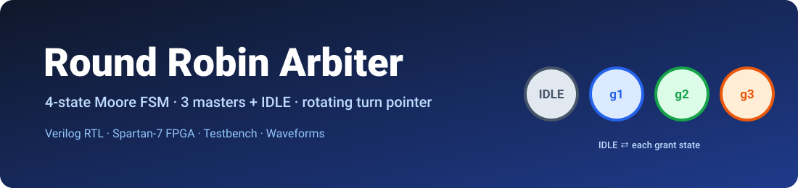
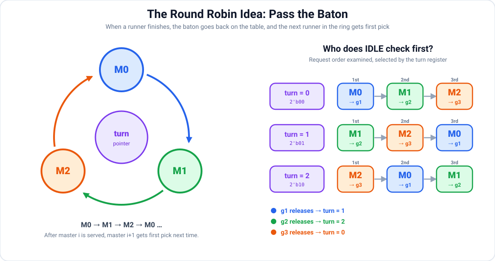
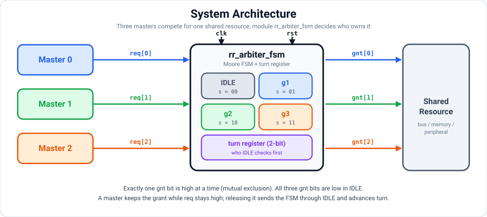
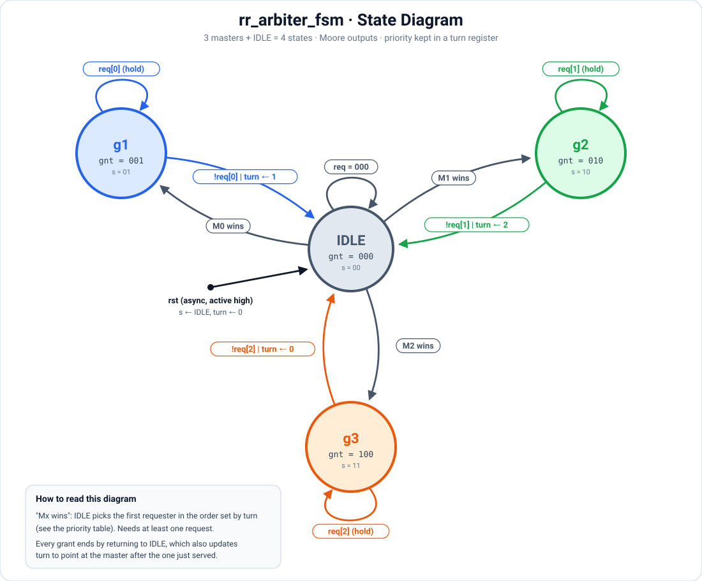
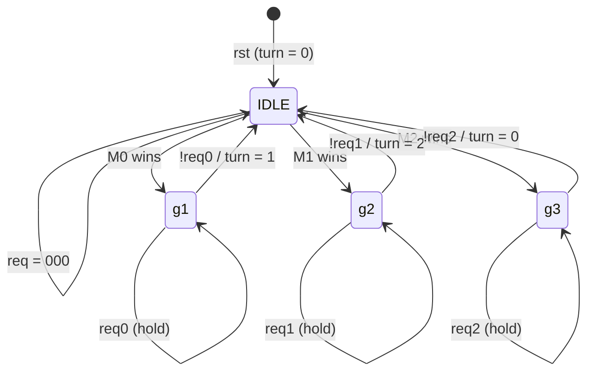
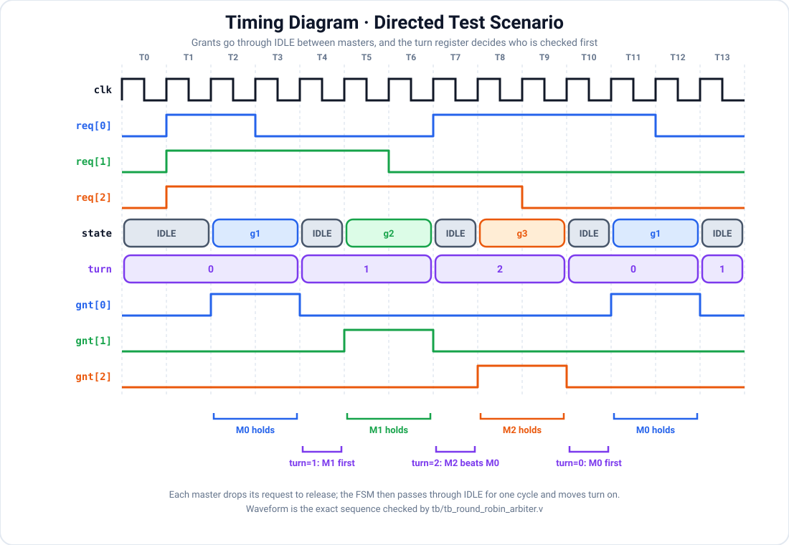

<p align="center">
  
</p>

<p align="center">
  
  
  
  
  
  
</p>

<h1 align="center">Round Robin Arbiter (FSM-Based)</h1>

<p align="center">
  <b>A three-master round robin arbiter built as a clean four-state Moore FSM in synthesizable Verilog, with a rotating <code>turn</code> pointer that keeps the arbitration fair, and implemented on a Spartan-7 FPGA.</b>
</p>

<p align="center">
  <a href="#-overview">Overview</a> ·
  <a href="#-the-round-robin-idea">Concept</a> ·
  <a href="#-architecture">Architecture</a> ·
  <a href="#-fsm-design">FSM</a> ·
  <a href="#-walkthrough-of-a-real-run">Waveform</a> ·
  <a href="#-rtl-implementation">RTL</a> ·
  <a href="#-verification">Verification</a> ·
  <a href="#-how-to-run">Run it</a>
</p>

---

## 📌 Overview

Whenever several blocks of a chip want the same shared resource at the same time (a memory, a bus, a peripheral), something has to decide who goes first. That something is an **arbiter**, and the policy it follows decides whether the system is fast, fair, or quietly unfair to one unlucky master.

This project implements a **round robin arbiter** for **three masters**. The heart of the design is a **finite state machine with exactly four states**: one `IDLE` state for when the resource is free, and one grant state for each master (`g1`, `g2`, `g3`, serving master 0, 1 and 2). The machine hands the resource to one master at a time. A master keeps the grant for as long as it holds its request high, and when it lets go the FSM returns to `IDLE` and a small **`turn` register** moves the priority on to the next master in the ring. From then on, the master that follows the one just served is always checked first. No master can jump the queue repeatedly, and a master that keeps requesting waits for at most two other grants, as long as the masters release the resource when they finish.

The design is small on purpose. It is the kind of block that appears inside real interconnects, DMA controllers and memory controllers, which makes it a good vehicle for showing disciplined RTL: a clean state encoding, a Moore output that cannot glitch, a separate priority register that keeps the FSM readable, and a self-checking testbench that proves the behaviour instead of just eyeballing a waveform.

| | |
|---|---|
| **Masters** | 3 (`req[0]`, `req[1]`, `req[2]`) |
| **States** | 4 (`IDLE`, `g1`, `g2`, `g3`) |
| **FSM type** | Moore (outputs depend only on the current state) |
| **Fairness mechanism** | 2-bit `turn` register selects who `IDLE` checks first |
| **Grant format** | One-hot `gnt[2:0]`, or `000` when idle |
| **Reset** | Asynchronous, active high (`rst`) |
| **Request → grant latency** | 1 clock cycle when the arbiter is idle |
| **Hand-off cost** | 1 `IDLE` cycle between two consecutive grants |
| **Worst-case wait** | 2 other grants, provided each master releases its request |

---

## 📋 Summary of Project 

| Parameter | Details |
|---|---|
| **FPGA Board Family** | Xilinx Spartan-7 |
| **FPGA Part Number** | `xc7s50csga324-1` |
| **FPGA Device** | XC7S50 |
| **Package** | CSGA324 |
| **Speed Grade** | -1 |
| **HDL Language** | Verilog |
| **Simulation Tool** | Vivado Simulator |
| **Top Module Name** | `top` |
| **Project Name** | `round_robin_arbiter_fsm` |

---

## 🎡 The Round Robin Idea

The easiest way to picture round robin arbitration is a **relay race**. Only the runner holding the baton is allowed to run. When that runner finishes, the baton goes back on the table (`IDLE`), and the *next* runner in the ring, not the one who just ran, gets first pick of it. If that runner is not on the track, the baton goes to the one after. If nobody wants it, it simply stays on the table.

<p align="center">
  
</p>

The `turn` pointer in the middle is what remembers whose go it is. The table on the right is the whole policy in one picture: each row is a value of `turn`, and the three chips show the order in which the masters are examined when the arbiter is idle. Every row is the previous row rotated by one position, and that rotation *is* the fairness.

---

## 🧱 Architecture

The arbiter sits between three requesting masters and one shared resource. Each master raises its own request line, the FSM decides who owns the resource, and exactly one grant line goes high in response.

<p align="center">
  
</p>

### Port list

The design is the module `rr_arbiter_fsm`.

| Port | Direction | Width | Description |
|---|---|---|---|
| `clk` | input | 1 | System clock, all state changes happen on the rising edge |
| `rst` | input | 1 | Asynchronous reset, active high, forces the FSM into `IDLE` and `turn` to 0 |
| `req` | input | 3 | Request lines, `req[i]` is asserted by master *i* and held until it is served |
| `gnt` | output | 3 | Grant lines, `gnt[i]` high means master *i* owns the resource |

---

## 🧠 FSM Design

### State diagram

The three masters plus the idle state give four states in total. Every grant starts from `IDLE`: the arbiter looks at the requests in the order chosen by `turn` and the first requester that it finds "wins" and gets its grant state. A grant state holds itself while that master keeps its request high (the self loop), and when the master drops the request the FSM goes back to `IDLE` and updates `turn` so that the next master in the ring is checked first.

<p align="center">
  
</p>

### State encoding and outputs

| State | Encoding `s` | `gnt[2:0]` | Meaning |
|---|:---:|:---:|---|
| `IDLE` | `2'b00` | `000` | Resource is free |
| `g1` | `2'b01` | `001` | Master 0 owns the resource |
| `g2` | `2'b10` | `010` | Master 1 owns the resource |
| `g3` | `2'b11` | `100` | Master 2 owns the resource |

### Transition table

| Current state | Condition | Next state | `turn` update |
|---|---|---|---|
| `IDLE` | at least one request | `g1`, `g2` or `g3` (winner chosen by `turn`, see below) | unchanged |
| `IDLE` | `req == 000` | `IDLE` | unchanged |
| `g1` | `req[0]` | `g1` *(hold)* | unchanged |
| `g1` | `!req[0]` | `IDLE` | `turn ← 1` |
| `g2` | `req[1]` | `g2` *(hold)* | unchanged |
| `g2` | `!req[1]` | `IDLE` | `turn ← 2` |
| `g3` | `req[2]` | `g3` *(hold)* | unchanged |
| `g3` | `!req[2]` | `IDLE` | `turn ← 0` |

### The `turn` register: who `IDLE` checks first

This is where the round robin behaviour lives. The register holds a value from 0 to 2, and each value defines a different priority order for leaving `IDLE`. The rule for updating it is simple: **whenever master *i* finishes, `turn` is set so that master *i+1* is checked first next time.**

| `turn` | Check order | Resulting grant |
|:---:|:---:|---|
| `0` | M0 → M1 → M2 | `req[0]` → `g1`, else `req[1]` → `g2`, else `req[2]` → `g3` |
| `1` | M1 → M2 → M0 | `req[1]` → `g2`, else `req[2]` → `g3`, else `req[0]` → `g1` |
| `2` | M2 → M0 → M1 | `req[2]` → `g3`, else `req[0]` → `g1`, else `req[1]` → `g2` |

`turn` starts at 0 after reset, and the value `2'b11` is never reached because it is only ever loaded with 0, 1 or 2.

<details>
<summary><b>Prefer Mermaid? Click for a text-based version of the same diagram (renders natively on GitHub)</b></summary>



</details>

### Design properties

The structure of the machine gives several guarantees, and the testbench checks the first one on every clock edge.

- **Mutual exclusion.** `gnt` is decoded straight from the state register, and each state sets a single bit, so at most one grant can ever be high. Two masters can never own the resource at the same time.
- **Fairness through rotating priority.** After master *i* is served, master *i+1* gets first pick. A master that keeps requesting therefore waits for at most two other grants, provided each master releases its request in finite time.
- **Work conserving.** If anyone is requesting while the arbiter is idle, a grant is issued on the next clock edge. The resource is never left idle while a request is pending.
- **Glitch-free outputs.** This is a Moore machine, so `gnt` depends only on the registered state `s` and never on the raw request inputs. There is no combinational path from `req` to `gnt`.
- **Non-preemptive by design.** A master keeps the resource for as long as it holds its request high. This is the right behaviour for multi-cycle transfers, and it means fairness relies on masters releasing the resource when they are done.
- **One `IDLE` cycle between grants.** Every hand-off passes through `IDLE`, which keeps the FSM simple and the outputs clean, at the cost of one idle cycle per hand-off.

---

## 🔍 Walkthrough of a Real Run

The waveform below comes from the directed test in the testbench. It was chosen to exercise every interesting behaviour in a handful of cycles.

<p align="center">
  
</p>

At `T1` all three masters raise their requests together and the `turn` register is 0, so master 0 is chosen first and gets `g1` for the whole time it keeps its request high. Masters 1 and 2 simply wait. When master 0 lets go in `T3`, the FSM returns to `IDLE` for one cycle and `turn` moves to 1, which means master 1 is now checked first. Master 1 is served in `g2`, even though master 2 has also been waiting, and when it releases, `turn` moves to 2.

The most interesting moment is `T7`. Master 0 has come back and is requesting again at the same time as master 2. A fixed-priority arbiter would give master 0 the grant, because it has the lowest index, but `turn` is 2, so master 2 is checked first and wins. That is the round robin policy doing its job: master 2 had been waiting since `T1`, and it is served after exactly two other grants. Master 0 gets its turn next, in `g1`, and once every request is gone the machine returns to `IDLE`.

| Cycle | `req[2:0]` | State | `turn` | `gnt[2:0]` | What happened |
|:---:|:---:|:---:|:---:|:---:|---|
| T0 | `000` | `IDLE` | 0 | `000` | Nobody is asking |
| T1 | `111` | `IDLE` | 0 | `000` | All three request, `turn = 0` so M0 is chosen |
| T2 | `111` | `g1` | 0 | `001` | M0 is granted and keeps requesting |
| T3 | `110` | `g1` | 0 | `001` | M0 drops its request, the grant ends at the next edge |
| T4 | `110` | `IDLE` | 1 | `000` | Back in `IDLE`, `turn` advances to 1 |
| T5 | `110` | `g2` | 1 | `010` | M1 is checked first and granted, M2 keeps waiting |
| T6 | `100` | `g2` | 1 | `010` | M1 drops its request |
| T7 | `101` | `IDLE` | 2 | `000` | `turn = 2`, M0 and M2 both request |
| T8 | `101` | `g3` | 2 | `100` | M2 wins over M0 because of `turn`, after waiting two grants |
| T9 | `001` | `g3` | 2 | `100` | M2 drops its request |
| T10 | `001` | `IDLE` | 0 | `000` | `turn` wraps around to 0 |
| T11 | `001` | `g1` | 0 | `001` | M0 is finally served |
| T12 | `000` | `g1` | 0 | `001` | M0 drops its request |
| T13 | `000` | `IDLE` | 1 | `000` | Resource is free, `turn = 1` |

---

## 💻 RTL Implementation

The module uses a clean **two-process FSM coding style**. One clocked block holds the registers (the state `s` and the priority pointer `turn`), and one combinational block computes the next state, the next `turn` and the Moore output `gnt`. Keeping the priority in its own register means the FSM itself stays at four states, and the round robin behaviour is easy to read straight from the `IDLE` branch.

```verilog
module rr_arbiter_fsm(gnt,req,clk,rst); 
output reg [2:0]gnt;
input wire [2:0] req;
input clk,rst;

localparam IDLE=2'b00,
g1=2'b01,
g2=2'b10,
g3=2'b11;

reg [2:0]ns,s;
reg [1:0]turn,next_turn;

always @(posedge clk or posedge rst)
begin 
if(rst)
    begin
    s<=IDLE;
    turn <= 1'b0;
    end
else
    begin
    s<=ns;
    turn <= next_turn;
    end 
end

always @ (*)
begin
ns=s;
next_turn=turn;
gnt=1'b0;

case(s)
IDLE: begin
    if (turn == 2'b00) begin
        if (req[0])      
            ns = g1;
        else if (req[1]) 
            ns = g2;
        else if (req[2]) 
            ns = g3;
    end
    else if (turn == 2'b01) begin
         if (req[1])      
            ns = g2;
         else if (req[2]) 
            ns = g3;
         else if (req[0]) 
            ns = g1;
    end
    else if (turn == 2'b10) begin
         if (req[2])      
            ns = g3;
         else if (req[0]) 
            ns = g1;
         else if (req[1]) 
            ns = g2;
    end
end 
g1: begin
     gnt[0]=1;                 
     if (req[0]) begin
        ns = g1 ;
     end               
     else begin
         ns = IDLE;
         next_turn = 2'b01;        
     end
end 
      
g2: begin
    gnt[1]=1;                 
    if (req[1]) begin
       ns = g2;
       end 
    else begin
       ns = IDLE;
       next_turn = 2'b10;       
       end
end 

g3: begin
    gnt[2]=1;                 
    if (req[2]) begin
        ns = g3;
    end 
    else begin
        ns = IDLE;
        next_turn = 2'b00;       
    end
end

default: begin
    ns = IDLE;
    next_turn = 2'b00;
    gnt=1'b0;
end

endcase

end 

endmodule
```

A few deliberate choices are worth calling out. The priority lives in the separate `turn` register instead of being encoded into extra FSM states, so the machine stays at four states while still rotating fairly. `ns`, `next_turn` and `gnt` are all given default values at the top of the combinational block, so every path assigns them and no accidental latches are inferred. The `default` branch sends any unexpected state back to `IDLE` and resets `turn`, so the machine recovers safely. The grant is a one-hot vector, which means downstream logic can use each bit directly as an enable with no decoding, and because `gnt` is set only from the state, the output is a clean Moore output.

The full source is in [`rtl/round_robin_arbiter.v`](rtl/round_robin_arbiter.v).

---

## ✅ Verification

The testbench in [`tb/tb_round_robin_arbiter.v`](tb/tb_round_robin_arbiter.v) is **self-checking**, so a pass or fail is decided by the code rather than by someone squinting at a waveform. It does two jobs at once:

1. **A continuous safety check** runs on every rising clock edge and flags an error if more than one grant bit is ever high, which proves mutual exclusion for the whole run.
2. **A directed scenario** drives the request pattern shown in the timing diagram and compares both the grant and the `turn` register against the expected value in every cycle. It covers a three-way contention, masters holding and releasing the grant, the `turn` pointer rotating 0 → 1 → 2 → 0, and a case where `turn` makes a higher-numbered master beat master 0.

---

## 🎥 Demonstration

[▶ Watch the FPGA demo](demonstration/round_robin_demonstration(1).mp4)   

---

## 🚀 How to Run

### Vivado (the flow used for this project)

1. Create a project for the `xc7s50csga324-1` part and add `rtl/round_robin_arbiter.v` as a design source.
2. Add `tb/tb_round_robin_arbiter.v` as a simulation source and set `tb_round_robin_arbiter` as the simulation top.
3. Click **Run Simulation → Run Behavioral Simulation**. The PASS / FAIL lines appear in the Tcl console.
4. In the waveform window, add `dut/s` and `dut/turn` to see the internal state and the priority pointer next to `req` and `gnt`.

### Icarus Verilog and GTKWave (optional, no Vivado needed)

```bash
# compile the design and the testbench
iverilog -o sim rtl/round_robin_arbiter.v tb/tb_round_robin_arbiter.v

# run the simulation (prints PASS/FAIL for every cycle)
vvp sim

# open the generated waveform
gtkwave round_robin_arbiter.vcd
```

In GTKWave, add `clk`, `req`, `gnt`, `dut.s` and `dut.turn` to the signal view to reproduce the timing diagram above.

---

## 📁 Repository Structure

```text
round-robin-arbiter/
├── assets/
│   ├── banner.svg
│   ├── block_diagram.svg
│   ├── fsm_state_diagram.svg
│   ├── round_robin_concept.svg
│   └── timing_diagram.svg
├── rtl/
│   ├── round_robin_arbiter.v     
│   ├── top_module.v             
│   └── clk_division.v           
├── tb/
│   └── tb_round_robin_arbiter.v  
└── README.md
```

---

## 🔭 Possible Extensions

The design is deliberately minimal, which leaves room to grow it in interesting directions:

- **Add a maximum hold time** so that a master that never drops its request cannot keep the resource forever.
- **Remove the `IDLE` hand-off cycle** by allowing a direct grant-to-grant transition when another master is already waiting.
- **Parameterize the number of masters** (`N`) and generate the rotating priority logic instead of hand-writing each `turn` case.
- **Weighted round robin**, giving some masters a larger share of the bandwidth.
- **Formal verification** with SymbiYosys, proving mutual exclusion and bounded wait as assertions rather than relying only on simulation.
- **Implementation report**, adding the utilization and timing numbers for the XC7S50 to this README.

---

## 🎯 What This Project Demonstrates

Beyond the arbiter itself, this repository is meant to show a way of working: translating a policy ("be fair") into a precise state machine, choosing an encoding and coding style on purpose, reasoning about guarantees such as mutual exclusion and bounded wait instead of hoping for them, and backing every claim with a self-checking testbench. The diagrams are included for the same reason: a design that cannot be explained clearly is rarely understood fully.

---

## 👤 Author

**Vidharshana Sri S S**      
Electronics and Communication Engineering undergraduate focused on RTL and digital design, and currently looking for VLSI / RTL design internship opportunities.   

More of my Verilog and RTL learning work lives in [**Verilog-Core-Labs**](https://github.com/Vidharshanasri-SS/Verilog-Core-Labs).      

📧 Email:vidharshanasri.ss@gmail.com     

💼 LinkedIn: https://linkedin.com/vidharshanasrisivakumar   

🐙 GitHub: https://github.com/Vidharshanasri-SS   
   
If this project helped you or you spot something to improve, feel free to open an issue or reach out.   

<p align="center">
  <sub>Built with Verilog on Vivado, verified in simulation, explained with way too many diagrams.</sub>
</p>
