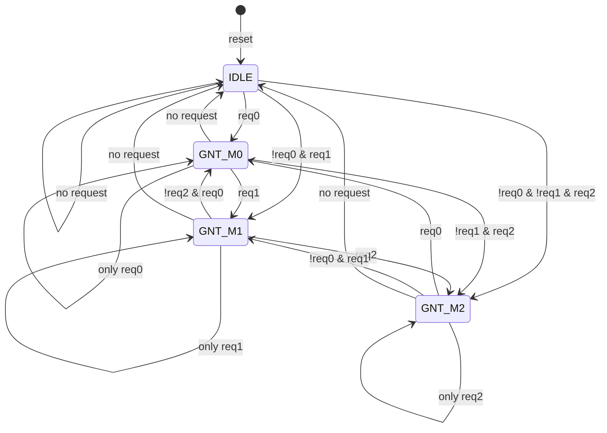

<p align="center">
  
</p>

<p align="center">
  
  
  
  
  
</p>

<h1 align="center">Round Robin Arbiter (FSM-Based)</h1>

<p align="center">
  <b>A fair, starvation-free, three-master bus arbiter built as a clean four-state Moore FSM in synthesizable Verilog.</b>
</p>

<p align="center">
  <a href="#-overview">Overview</a> ·
  <a href="#-the-round-robin-idea">Concept</a> ·
  <a href="#-architecture">Architecture</a> ·
  <a href="#-fsm-design">FSM</a> ·
  <a href="#-walkthrough-of-a-real-run">Waveform</a> ·
  <a href="#-rtl-implementation">RTL</a> ·
  <a href="#-verification">Verification</a> ·
  <a href="#-how-to-run">Run it</a>
</p>

---

## 📌 Overview

Whenever several blocks of a chip want the same shared resource at the same time (a memory, a bus, a peripheral), something has to decide who goes first. That something is an **arbiter**, and the policy it follows decides whether the system is fast, fair, or quietly unfair to one unlucky master.

This project implements a **round robin arbiter** for **three masters**. The heart of the design is a **finite state machine with exactly four states**: one `IDLE` state for when nobody is asking, and one grant state for each master (`GNT_M0`, `GNT_M1`, `GNT_M2`). The machine hands the resource to one master at a time and, after every grant, rotates its priority so that the master sitting next in line is always checked first. No master can monopolise the resource and none can be starved: a master that keeps requesting is guaranteed to be served after at most two other grants.

The design is small on purpose. It is the kind of block that appears inside real interconnects, DMA controllers and memory controllers, which makes it a good vehicle for showing disciplined RTL: a clean state encoding, a three-block FSM coding style, a Moore output that cannot glitch, and a self-checking testbench that proves the behaviour instead of just eyeballing a waveform.

| | |
|---|---|
| **Masters** | 3 (`req[0]`, `req[1]`, `req[2]`) |
| **States** | 4 (`IDLE`, `GNT_M0`, `GNT_M1`, `GNT_M2`) |
| **FSM type** | Moore (outputs depend only on the current state) |
| **Grant format** | One-hot `gnt[2:0]`, or `000` when idle |
| **Reset** | Asynchronous, active low (`rst_n`) |
| **Request → grant latency** | 1 clock cycle |
| **Worst-case wait** | 2 other grants (no starvation) |

---

## 🎡 The Round Robin Idea

The easiest way to picture round robin arbitration is a **relay race**. Only the runner holding the baton is allowed to run, and the moment they finish, the baton goes to the *next* runner in the ring, not back to the one who just ran. If the next runner is not on the track, the baton skips ahead to the one after. If nobody wants it, the baton rests on the table (`IDLE`).

<p align="center">
  
</p>

The table on the right is the whole policy in one picture. Each row is a current state, and the three chips show the order in which the masters are examined to decide the next state. Notice that every row is just the previous row rotated by one position. That rotation *is* the fairness.

---

## 🧱 Architecture

The arbiter sits between three requesting masters and one shared resource. Each master raises its own request line, the FSM decides who owns the resource this cycle, and exactly one grant line goes high in response.

<p align="center">
  
</p>

### Port list

| Port | Direction | Width | Description |
|---|---|---|---|
| `clk` | input | 1 | System clock, all state changes happen on the rising edge |
| `rst_n` | input | 1 | Asynchronous reset, active low, forces the FSM into `IDLE` |
| `req` | input | 3 | Request lines, `req[i]` is asserted by master *i* |
| `gnt` | output | 3 | Grant lines, `gnt[i]` high means master *i* owns the resource |

---

## 🧠 FSM Design

### State diagram

The three masters plus the idle state give four states in total. Solid arrows follow the natural round robin order. Dashed arrows are the *skip* paths, used when the next master in line is not requesting and the arbiter has to look one step further. Self loops mean the current master keeps the resource because nobody else is asking, and every grant state drops back to `IDLE` when all requests disappear.

<p align="center">
  
</p>

### State encoding and outputs

| State | Encoding | `gnt[2:0]` | Meaning |
|---|:---:|:---:|---|
| `IDLE` | `2'b00` | `000` | No master owns the resource |
| `GNT_M0` | `2'b01` | `001` | Master 0 owns the resource |
| `GNT_M1` | `2'b10` | `010` | Master 1 owns the resource |
| `GNT_M2` | `2'b11` | `100` | Master 2 owns the resource |

### Transition table

The "check order" column is where the round robin behaviour lives. It is the order in which the request lines are examined, and it changes with the current state.

| Current state | Check order | Condition | Next state |
|---|:---:|---|---|
| `IDLE` | M0 → M1 → M2 | `req[0]` | `GNT_M0` |
| | | `!req[0] & req[1]` | `GNT_M1` |
| | | `!req[0] & !req[1] & req[2]` | `GNT_M2` |
| | | `req == 000` | `IDLE` |
| `GNT_M0` | M1 → M2 → M0 | `req[1]` | `GNT_M1` |
| | | `!req[1] & req[2]` | `GNT_M2` |
| | | `!req[1] & !req[2] & req[0]` | `GNT_M0` *(hold)* |
| | | `req == 000` | `IDLE` |
| `GNT_M1` | M2 → M0 → M1 | `req[2]` | `GNT_M2` |
| | | `!req[2] & req[0]` | `GNT_M0` |
| | | `!req[2] & !req[0] & req[1]` | `GNT_M1` *(hold)* |
| | | `req == 000` | `IDLE` |
| `GNT_M2` | M0 → M1 → M2 | `req[0]` | `GNT_M0` |
| | | `!req[0] & req[1]` | `GNT_M1` |
| | | `!req[0] & !req[1] & req[2]` | `GNT_M2` *(hold)* |
| | | `req == 000` | `IDLE` |

<details>
<summary><b>Prefer Mermaid? Click for a text-based version of the same diagram (renders natively on GitHub)</b></summary>



</details>

### Design properties

The structure of the machine gives several guarantees for free, and the testbench checks the first one on every clock edge.

- **Mutual exclusion.** `gnt` is decoded straight from the state register, so at most one bit can ever be high. Two masters can never own the resource simultaneously.
- **Fairness and no starvation.** Priority starts one step past the current owner, so a master that keeps requesting waits for at most two other grants before it is served.
- **Work conserving.** If anyone is requesting, someone is granted on the next cycle. The arbiter never idles while a request is pending.
- **Glitch-free outputs.** This is a Moore machine, so `gnt` depends only on the registered state and never on the raw request inputs. There is no combinational path from `req` to `gnt`.
- **Predictable latency.** A request is sampled on one clock edge and the grant appears after it, giving a fixed one-cycle response.

---

## 🔍 Walkthrough of a Real Run

The waveform below comes from the directed test in the testbench. It was chosen to exercise every interesting behaviour in a handful of cycles.

<p align="center">
  
</p>

Reading it from left to right tells the whole story. Nothing happens in `T0` and `T1` while the FSM sits in `IDLE`. At `T1` all three masters raise their requests together, and the arbiter serves them in perfect rotation: `GNT_M0`, then `GNT_M1`, then `GNT_M2`, one cycle each. That is round robin fairness in its purest form. At `T4` master 0 stops asking, so when the arbiter leaves `GNT_M2` it *skips* master 0 and moves straight to master 1. A cycle later master 1 has also gone quiet, so the grant goes to master 2, and when master 0 returns the priority wraps back around to it. In `T7` master 0 is the only one requesting, so it simply keeps the grant, and once every request disappears the machine releases the resource and returns to `IDLE`.

| Cycle | `req[2:0]` | State | `gnt[2:0]` | What happened |
|:---:|:---:|:---:|:---:|---|
| T0 | `000` | `IDLE` | `000` | Nobody is asking |
| T1 | `111` | `IDLE` | `000` | All three request, priority starts at M0 |
| T2 | `111` | `GNT_M0` | `001` | M0 served first |
| T3 | `111` | `GNT_M1` | `010` | Priority rotates to M1 |
| T4 | `110` | `GNT_M2` | `100` | Priority rotates to M2, M0 stops requesting |
| T5 | `100` | `GNT_M1` | `010` | M0 is skipped, M1 is served |
| T6 | `101` | `GNT_M2` | `100` | M1 has left, M2 is served |
| T7 | `001` | `GNT_M0` | `001` | Priority wraps back around to M0 |
| T8 | `000` | `GNT_M0` | `001` | M0 was the only requester, so it held the grant |
| T9 | `000` | `IDLE` | `000` | No requests, resource released |
| T10 | `000` | `IDLE` | `000` | Idle |

---

## 💻 RTL Implementation

The module uses the classic **three-block FSM coding style**, which keeps sequential and combinational logic cleanly separated and maps predictably onto hardware: a state register, a next-state block, and an output block. The next-state block is where the rotating priority lives, and it reads almost exactly like the transition table above.

```verilog
module rr_arbiter_fsm(gnt,req,clk,rst); 
output reg [2:0]gnt;
input wire [2:0] req;
input clk,rst;

localparam IDLE=2'b00,
g1=2'b01,
g2=2'b10,
g3=2'b11;

reg [2:0]ns,s;
reg [1:0]turn,next_turn;

always @(posedge clk or posedge rst)
begin 
if(rst)
    begin
    s<=IDLE;
    turn <= 1'b0;
    end
else
    begin
    s<=ns;
    turn <= next_turn;
    end 
end

always @ (*)
begin
ns=s;
next_turn=turn;
gnt=1'b0;

case(s)
IDLE: begin
    if (turn == 2'b00) begin
        if (req[0])      
            ns = g1;
        else if (req[1]) 
            ns = g2;
        else if (req[2]) 
            ns = g3;
    end
    else if (turn == 2'b01) begin
         if (req[1])      
            ns = g2;
         else if (req[2]) 
            ns = g3;
         else if (req[0]) 
            ns = g1;
    end
    else if (turn == 2'b10) begin
         if (req[2])      
            ns = g3;
         else if (req[0]) 
            ns = g1;
         else if (req[1]) 
            ns = g2;
    end
end 
g1: begin
     gnt[0]=1;                 
     if (req[0]) begin
        ns = g1 ;
     end               
     else begin
         ns = IDLE;
         next_turn = 2'b01;        
     end
end 
      
g2: begin
    gnt[1]=1;                 
    if (req[1]) begin
       ns = g2;
       end 
    else begin
       ns = IDLE;
       next_turn = 2'b10;       
       end
end 

g3: begin
    gnt[2]=1;                 
    if (req[2]) begin
        ns = g3;
    end 
    else begin
        ns = IDLE;
        next_turn = 2'b00;       
    end
end

default: begin
    ns = IDLE;
    next_turn = 2'b00;
    gnt=1'b0;
end

endcase

end 

endmodule

```

A few deliberate choices are worth calling out. `IDLE` and `GNT_M2` share a branch because they use the same priority order (M0 first), which removes duplicated logic without changing behaviour. `next_state` is given a default value at the top of the block and a `default` case at the bottom, so there are no accidental latches and the unused-encoding case recovers safely to `IDLE`. The grant is a one-hot vector, which means downstream logic can use each bit directly as an enable with no decoding.

The full, commented source is in [`rtl/round_robin_arbiter.v`](rtl/round_robin_arbiter.v).

---

## ✅ Verification

The testbench in [`tb/tb_round_robin_arbiter.v`](tb/tb_round_robin_arbiter.v) is **self-checking**, so a pass or fail is decided by the code rather than by someone squinting at a waveform. It does two jobs at once:

1. **A continuous safety check** runs on every rising clock edge and flags an error if more than one grant bit is ever high, which proves mutual exclusion for the whole run.
2. **A directed scenario** drives the exact request pattern shown in the timing diagram and compares the grant in every cycle against an expected value, covering fair rotation, skipping an idle master, wrap-around, holding the grant, and returning to `IDLE`.

---

## 🚀 How to Run

You only need [Icarus Verilog](https://steveicarus.github.io/iverilog/) to simulate, and [GTKWave](https://gtkwave.sourceforge.net/) if you want to look at the waveform.

```bash
# compile the design and the testbench
iverilog -o sim rtl/round_robin_arbiter.v tb/tb_round_robin_arbiter.v

# run the simulation (prints PASS/FAIL for every cycle)
vvp sim

# open the generated waveform
gtkwave round_robin_arbiter.vcd
```

In GTKWave, add `clk`, `req`, `gnt` and `dut.state` to the signal view to reproduce the timing diagram above.

---

## 📁 Repository Structure

```text
round-robin-arbiter/
├── assets/
│   ├── banner.svg               
│   ├── block_diagram.svg        
│   ├── fsm_state_diagram.svg    
│   ├── round_robin_concept.svg  
│   └── timing_diagram.svg       
├── rtl/
│   └── round_robin_arbiter.v
|   └── top_module.v
|   └── clk_division.v
├── tb/
│   └── tb_round_robin_arbiter.v 
└── README.md
```

---

## 🔭 Possible Extensions

The design is deliberately minimal, which leaves room to grow it in interesting directions:

- **Parameterize the number of masters** (`N`) and generate the rotating priority logic instead of hand-writing each state.
- **Add a lock or burst input** so a master can keep the grant for a multi-cycle transfer without being pre-empted.
- **Weighted round robin**, giving some masters a larger share of the bandwidth.
- **Formal verification** with SymbiYosys, proving mutual exclusion and bounded wait as assertions rather than relying only on simulation.
- **FPGA or synthesis run**, reporting area and maximum frequency for the final netlist.

---

## 🎯 What This Project Demonstrates

Beyond the arbiter itself, this repository is meant to show a way of working: translating a policy ("be fair") into a precise state machine, choosing an encoding and coding style on purpose, reasoning about guarantees such as mutual exclusion and bounded wait instead of hoping for them, and backing every claim with a self-checking testbench. The diagrams are included for the same reason: a design that cannot be explained clearly is rarely understood fully.

---

## 👤 Author

**Vidharshana Sri S S**
Electronics and Communication Engineering undergraduate focused on RTL and digital design, and currently looking for VLSI / RTL design internship opportunities.

More of my Verilog and RTL learning work lives in [**Verilog-Core-Labs**](https://github.com/Vidharshanasri-SS/Verilog-Core-Labs).    

📧 Email:vidharshanasri.ss@gmail.com     

💼 LinkedIn: https://linkedin.com/vidharshanasrisivakumar   

🐙 GitHub: https://github.com/Vidharshanasri-SS   
   
If this project helped you or you spot something to improve, feel free to open an issue or reach out.   

<p align="center">
  <sub>Built with Verilog, verified with Icarus Verilog, explained with way too many diagrams.</sub>
</p>
